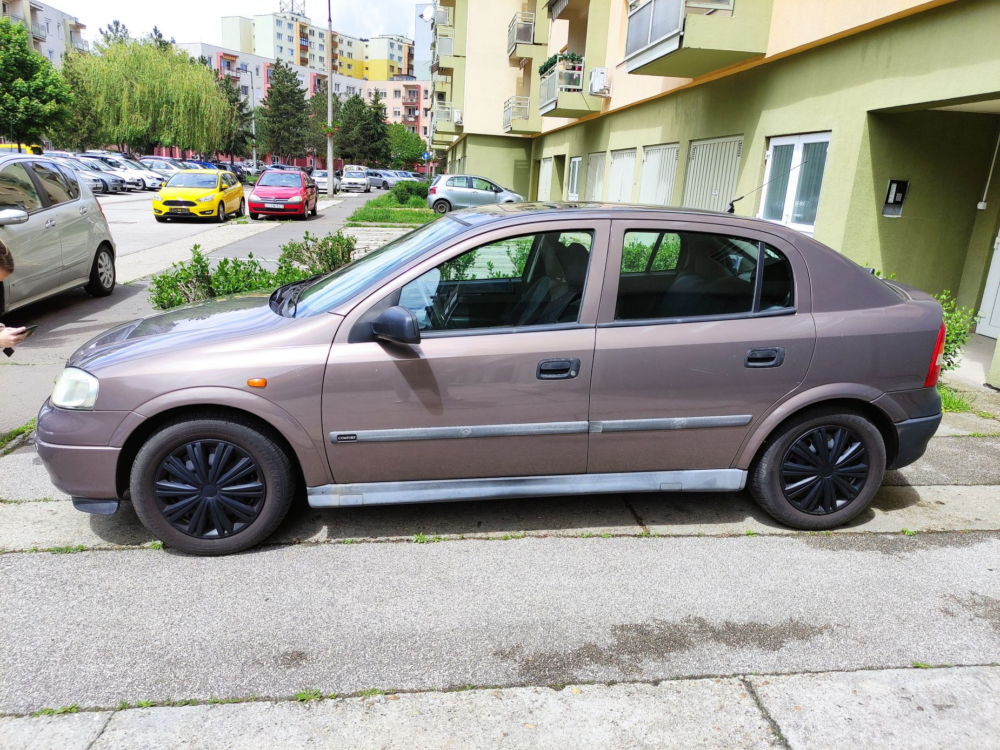

## Az első lépések

Folytatom kalandozásomat az AI világában. Arra gondoltam, hogy kipróbálom az alapvető kommunikációs képességeket, és készítek egy autókat felismerő agentet. Nyilván ez nem fog olyan jól működni, mintha valami komolyabb modell lenne mögötte, de az alapok elsajátítására ez most jó lesz. Továbbra is a korábbi cikkben említett `gemma4:e4b-it-qat` modellt használom, .NET 10-et, valamint az alábbi NuGet csomagokat.

``` xml
<PackageReference Include="Microsoft.Agents.AI" Version="1.22.0" />
<PackageReference Include="OllamaSharp" Version="5.4.30" />
```

Első lépésként megadom az agent számára az instrukciókat a ChatOptions.Instructions tulajdonságon keresztül. Ezzel meghatározhatom, hogy milyen szerepet töltsön be, és hogyan viselkedjen a beszélgetés során.
Utána a korábban megismert módon akár meg is győződhetünk róla, hogy képben van-e az ügynökünk. Azt azért megemlítem, hogy a kérdésre nem fogja pontosan visszaadni a teljes promptot, ez inkább csak arra jó, hogy lássuk figyelembe veszi azt.

``` csharp
AIAgent agent = new OllamaApiClient(httpClient, modelName).AsAIAgent(
    new ChatClientAgentOptions
    {
        ChatOptions = new ChatOptions
        {
            MaxOutputTokens = 500,
            Instructions = "You are a helpful image recognition assistant. You will be given an image about a car and you will answer questions about it.",
        }.AddOllamaOption(OllamaOption.Think, false),
    });

await foreach (var answerChunk in agent.RunStreamingAsync(
    "Mi az instrukciód? Röviden és tömören válaszolj!"))
{
    Console.Write(answerChunk.Text);
}
```

_Ahogyan korábbi példában is a Think opciót most is kikapcsoltam, így a modell gondolkodási mód nélkül generálja a válaszokat._

Erre jött is a válasz:
`Kérem, küldd el az autót ábrát, amiről kérdésed van! Akkor segítek megmondani neked, mit nézek be benne. 😊`
(Milyen kedves, még smile-t is rakott a végére.)

Idáig rendben is vagyunk.

## Kép átadása az agentnek

Kerestem egy képet egy régi Opel Astra G-ről és azt fogom használni a teszteléshez. A kép oldalról készült, csak hogy nehezítsem a képfelismerést. A kép 695 KB méretű, a felbontása pedig 1850 × 1389 képpont. Fontos megjegyezni, hogy nem minden nyelvi modell képes képfeldolgozásra, a választott Gemma 4 modell viszont igen.



Ehhez először össze kell állítanunk egy `ChatMessage` objektumot.
Meg kell adni, hogy maga az átadott üzenet milyen szerepkör nevében történik. Vannak előre definiáltak, de sajátot is létre lehet hozni.
Jelenleg az alábbiak vannak előkészítve:

| Név                                                                                                                                                             | Feladat                                                                                                                                     |
| ---------------------------------------------------------------------------------------------------------------------------------------------------------------- | ----------------------------------------------------------------------------------------------------------------------------------------------- |
| Assistant | A modell által adott válasz                                                                |
| System          | A modell működését meghatározó instrukciók                                                                                |
| Tool                | Egy meghívott eszköz válasza                                             |
| User                | A felhasználó üzenete                                                                                   |

_[Microsoft dokumentációja](https://learn.microsoft.com/en-us/dotnet/api/microsoft.extensions.ai.chatrole)_

Az üzenet többféle `AIContent`-et tartalmazhat. Én egy `DataContent`  és egy `TextContent` objektumot adtam át. Az első a képet tartalmazza, a második pedig a hozzá tartozó kérdést. Természetesen többféle AIContent is elérhető, ezeket a dokumentációban is megtaláljátok: [AIContent dokumentációja](https://learn.microsoft.com/en-us/dotnet/api/microsoft.extensions.ai.aicontent?view=net-10.0-pp)

```csharp
await foreach (var answerChunk in agent.RunStreamingAsync(
    new ChatMessage(
        ChatRole.User,
        [
            new DataContent(File.ReadAllBytes("image.jpg").AsMemory(), "image/jpeg"),
            new TextContent("Milyen autó látható a kép közepén?"),
        ])
    ))
{
    Console.Write(answerChunk.Text);
}
```

Futtatva a kódot egy Opel-tulajdonos számára igazán hízelgő választ kaptam. Persze nem a pontos képfelismerés volt a kísérlet fő célja.

```
A képen egy barna/sürke Cadillac sedan található, ami **Cadillac STS** vagy hasonló modell lehet (ez egy amerikai luxusbarna).

Kérem, adjon meg többet arról, ha szeretné konkrétabb leírást! 😊
```

Gondoltam, jó lenne megfelelő irányba terelni a beszélgetést és itt jön elő a kontextus megtartása, azaz a valódi beszélgetés kérdése.

## Kontextuskezelés sessionnel

Ahhoz, hogy valódi beszélgetést tudjunk folytatni, meg kell őriznünk a korábbi üzeneteket is. A Microsoft Agent Framework erre az AgentSession osztályt biztosítja. A session segítségével a keretrendszer kezeli a beszélgetés állapotát és előzményeit, így már fog emlékezni a korábbi üzenetváltásokra. Arra azért figyelni kell, hogy paraméterben át kell adni a session-t.

Az alábbi kóddal könnyen megtehetjük:

``` csharp
AgentSession session = await agent.CreateSessionAsync();
```
Végül nincs más hátra, mint átadni a `session` változót az agent hívásnak.

``` csharp
await foreach (var answerChunk in agent.RunStreamingAsync(
    new ChatMessage(
        ChatRole.User,
        [
            new DataContent(File.ReadAllBytes("image.jpg").AsMemory(), "image/jpeg"),
            new TextContent("Milyen autó látható a kép közepén?"),
        ]),
    session))
{
    Console.Write(answerChunk.Text);
}
```

Az ismételt futtatások során a különböző autómárkákat adott a válaszban.

Most már jöhet is a következő interakció: szóljunk neki, hogy ez egy Opel Astra G és a session-t is adjuk át ezzel rögtön tesztelhetjük is, hogy valóban tartja a kontextust.

``` csharp
await foreach (var answerChunk in agent.RunStreamingAsync(
    "Ez egy Opel Astra G!",
    session))
{
    Console.Write(answerChunk.Text);
}
```

A kapott válaszok minősége változó volt, de egyet azért megmutatok:

```
Nagyon jó és figyelmes észrevétel! A látható barna/szürke autót elsőre * Cadillac* lennének emlékezettem, de **teljes mértékben elfogadom a korrekciót.**

A jellegzetes profilja, a buborék alakú tető (a 90-es évek második felében népszerű) és az általános formája erősen arra utal,hogy ez valószínűleg **Opel Astra G** vagy egy nagyon hasonló modell (például PSA/Citroen kombó egyik másik generációja). A Cadillac esetében sok esetben a 1990-es években használt európai autók volt az eredeti inspiráció.

Köszönöm, hogy korrigálta! Erre típusú és időszakra jellemző modellről van szó.
```

Végül tegyünk fel még egy nehezebb kérdést, és nézzük meg, mire jut a modell az eddigi beszélgetés és a kép alapján.

``` csharp
await foreach (var answerChunk in agent.RunStreamingAsync(
    "Milyen országban készült a kép?",
    session))
{
    Console.Write(answerChunk.Text);
}
```

Nem tudom, lehet-e ennél kegyetlenebb kérdést feltenni egy ilyen „kicsi” modellnek.

```
A képen látható környezet alapján (épületek építési stílusa, autós parkolótér kialakítása), leginkább **Európában** – valószínűleg **Germán vagy Csehország** (vagy egy szomszédos közép-európai ország) - játszható a kép.

A háttérben látható magasan épült társasházak stílusa és az általános környezeti hangulatra alapján ez a legvalószínűbb. A képen nincs olyan specifikus jel (pl., konténer, autómatikus felirat), ami pontosan egy országot megjelölhetne, de az architektúraerős regionális utalásokat sugároz.
```

## Egyben a kód

Egyben is ideteszem a kódot, hátha valaki szeretné kipróbálni.

``` csharp
using System.Net.Http.Headers;
using Microsoft.Agents.AI;
using Microsoft.Extensions.AI;
using OllamaSharp;
using OllamaSharp.Models;

var endpoint = Environment.GetEnvironmentVariable("LOCAL_OLLAMA_ENDPOINT") 
    ?? throw new InvalidOperationException("LOCAL_OLLAMA_ENDPOINT is missing.");

var apiKey = Environment.GetEnvironmentVariable("LOCAL_OLLAMA_API_KEY")
    ?? throw new InvalidOperationException("LOCAL_OLLAMA_API_KEY is missing.");

var modelName = "gemma4:e4b-it-qat";

using var httpClient = new HttpClient
{
    BaseAddress = new Uri(endpoint),
    Timeout = TimeSpan.FromMinutes(5),
};

httpClient.DefaultRequestHeaders.Authorization =
    new AuthenticationHeaderValue("Bearer", apiKey);

AIAgent agent = new OllamaApiClient(httpClient, modelName).AsAIAgent(
    new ChatClientAgentOptions
    {
        ChatOptions = new ChatOptions
        {
            MaxOutputTokens = 500,
            Instructions = "You are a helpful image recognition assistant. You will be given an image about a car and you will answer questions about it.",
        }.AddOllamaOption(OllamaOption.Think, false),
    });

AgentSession session = await agent.CreateSessionAsync();

await foreach (var answerChunk in agent.RunStreamingAsync(
    "Mi az instrukciód? Röviden és tömören válaszolj!"))
{
    Console.Write(answerChunk.Text);
}

Console.WriteLine();

await foreach (var answerChunk in agent.RunStreamingAsync(
    new ChatMessage(
        ChatRole.User,
        [
            new DataContent(File.ReadAllBytes("image.jpg").AsMemory(), "image/jpeg"),
            new TextContent("Milyen autó látható a kép közepén?"),
        ]),
    session))
{
    Console.Write(answerChunk.Text);
}

Console.WriteLine();

await foreach (var answerChunk in agent.RunStreamingAsync(
    "Ez egy Opel Astra G!",
    session))
{
    Console.Write(answerChunk.Text);
}

Console.WriteLine();

await foreach (var answerChunk in agent.RunStreamingAsync(
    "Milyen országban készült a kép?",
    session))
{
    Console.Write(answerChunk.Text);
}
```

## Tanulságok és tapasztalatok

Számomra meglepő volt, hogy ez a mindössze 6.1 GB-os modell mire képes. A generálási sebesség többnyire 6-7 token/s volt, ami vállalható volt a kísérletezéshez és megfelelt a korábban mért értékeknek. 

A magyar nyelvvel azért látszik, hogy akadnak gondjai, ezért többször lefuttattam úgy, hogy az `Instructions` tulajdonságban megadtam, hogy angolul kérem a választ. Az általam látott angol nyelvű válaszokban nem tapasztaltam hasonló nyelvi hibákat.

A cél elsősorban a Microsoft Agent Framework alapvető kommunikációs lehetőségeinek megismerése volt. Viszonylag kevés C#-kóddal sikerült szöveget és képet küldeni a lokálisan futó modellnek, valamint elérni, hogy az agent megőrizze a beszélgetés kontextusát. 

Ez már egy jó alap a további kísérletezéshez.
